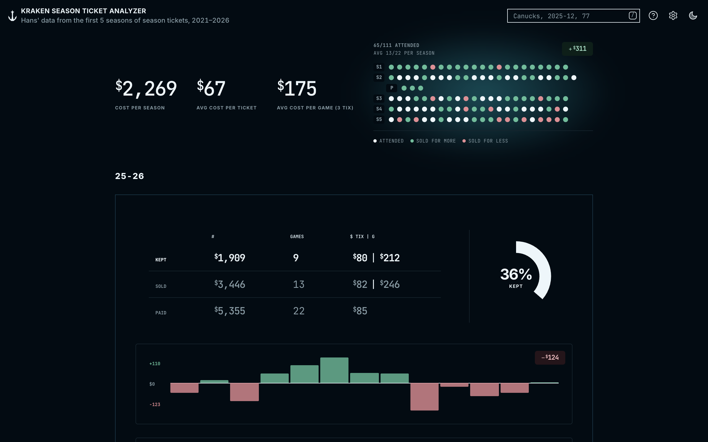
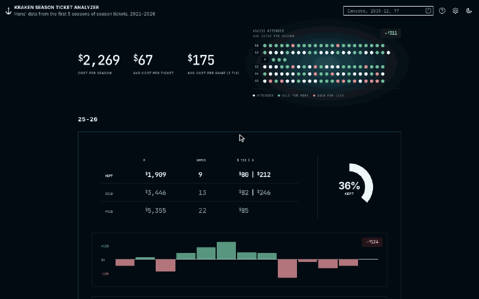
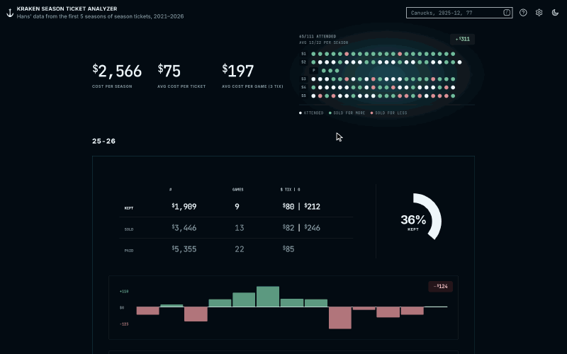
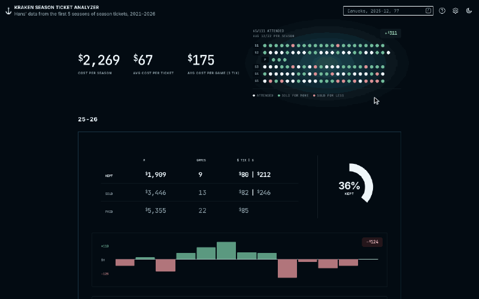
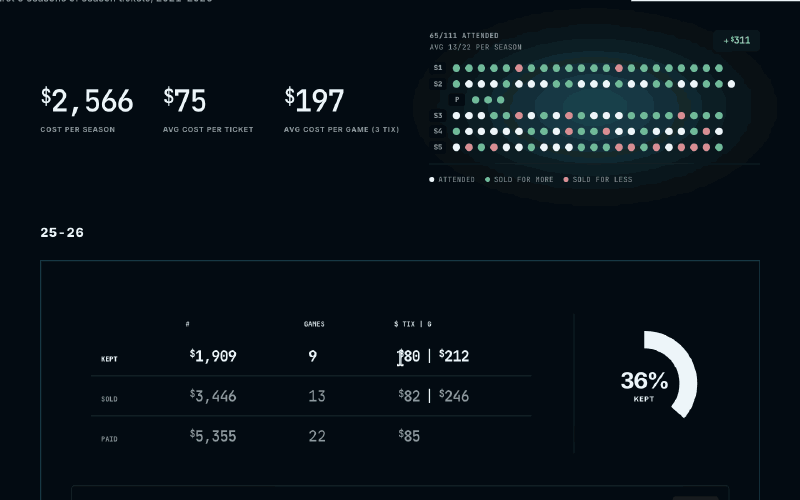

# `krakentix`

Five seasons of Seattle Kraken season tickets, every seat I kept or resold, laid out so you can see in one glance what the hockey actually cost.

  
[<kbd> haaans.com/krakentix  </kbd>](https://haaans.com/krakentix)

## Features

<table>
<tr valign="top">
<td width="50%">
<h3>Jump to any game</h3>

Every game is a dot on the mini-map. Hover one for the opponent and what the seats went for, click it and the page jumps to that sale and highlights it.

</td>
<td width="50%">

</td>
</tr>
<tr valign="top">
<td width="50%">

</td>
<td width="50%">
<h3>Search every season</h3>

Press <kbd>/</kbd> and type an opponent, a date or an amount. Every matching sale across all five seasons collapses into one chart and table.

</td>
</tr>
<tr valign="top">
<td width="50%">
<h3>Cycle the themes</h3>

One button walks through black and white, the original blueberry slate, and Kraken ink, each in light and dark.

</td>
<td width="50%">

</td>
</tr>
<tr valign="top">
<td width="50%">

</td>
<td width="50%">
<h3>Make your own</h3>

Copy the prompt from the About dialog into any AI assistant, then answer its questions and connect your email. It works out every game you kept or resold and builds this same site with your numbers, for any team. <a href="MAKE_YOUR_OWN.md">Here's what it follows</a>.

</td>
</tr>
</table>
